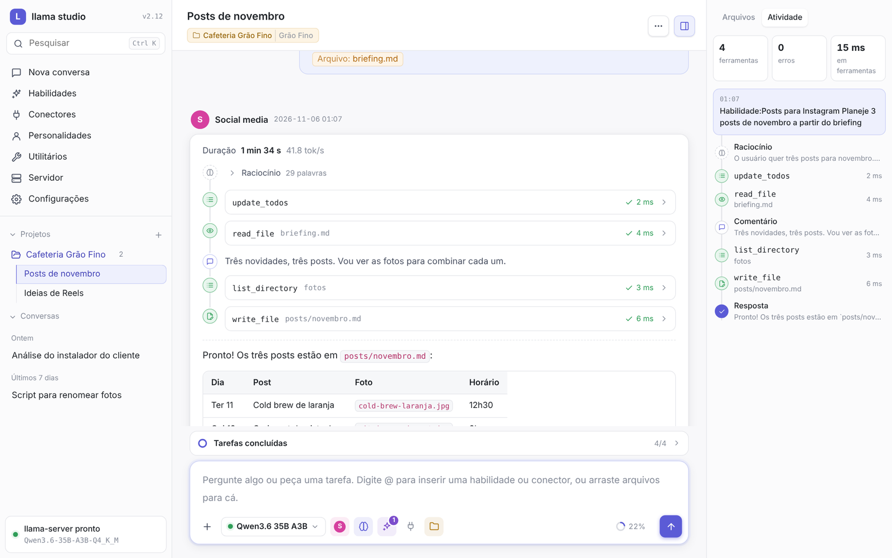
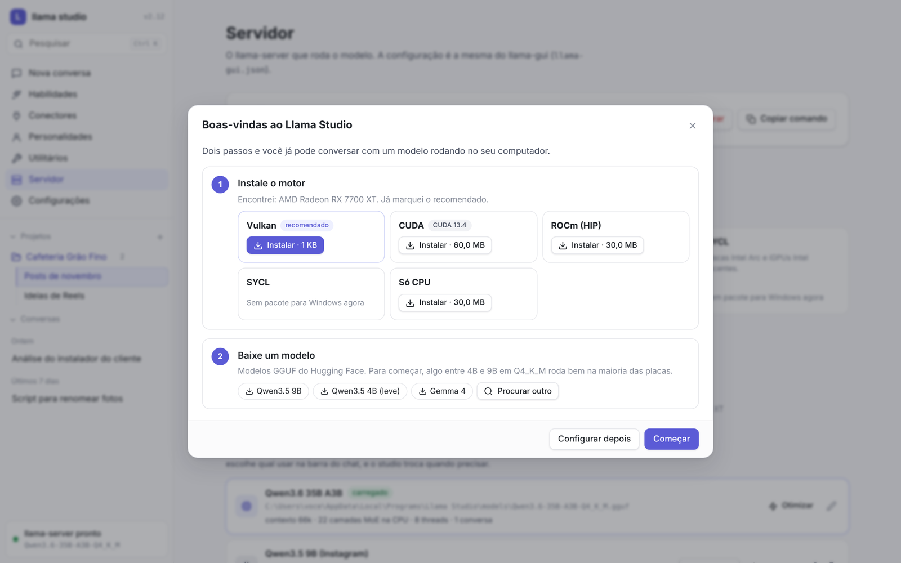
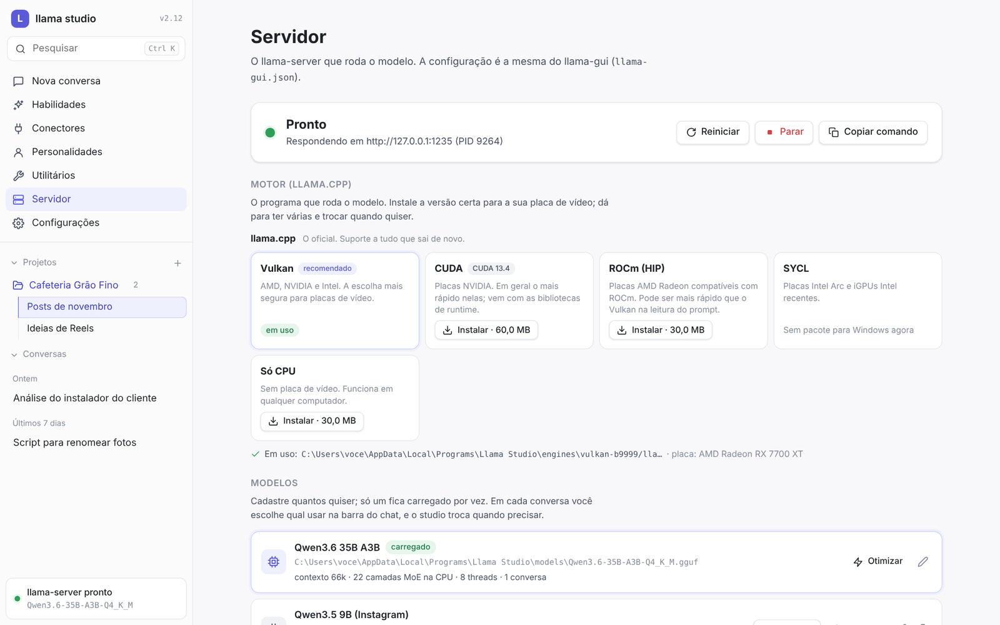
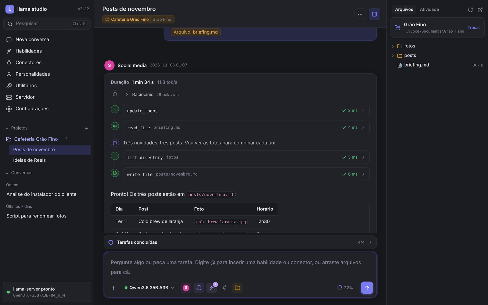

<p align="center">
  
</p>

<h1 align="center">Llama Studio</h1>

<p align="center">
  Um <b>agent harness</b> leve e otimizado para modelos locais no Windows.<br>
  Junta o <a href="https://github.com/ggml-org/llama.cpp">llama.cpp</a>, ferramentas, conectores MCP e habilidades numa janela só, sem roubar memória nem GPU do modelo.
</p>

<p align="center">
  <a href="../../releases/latest"><b>Baixar o instalador</b></a> ·
  <a href="#recursos">Recursos</a> ·
  <a href="#como-ele-economiza">Como ele economiza</a> ·
  <a href="#desenvolvimento">Desenvolvimento</a>
</p>

---

<p align="center">
  
</p>

O Llama Studio transforma o `llama-server` num agente que trabalha no seu computador: lê e edita arquivos, roda comandos, navega na web, controla aplicativos, chama conectores MCP e segue habilidades (`SKILL.md`), tudo com o modelo rodando localmente.

É um único executável em Rust (cerca de 5 MB) com a interface embutida. Ele foi feito para atrapalhar o mínimo possível o modelo: roda com prioridade baixa e em modo de economia de energia do Windows, a janela não usa a GPU, e ao fechar ela é destruída de verdade (o programa fica só na bandeja).

## Instalação

1. Baixe o `llama-studio-setup-X.Y.Z.exe` da [última versão](../../releases/latest).
2. Abra o programa. Na primeira vez, um guia sugere o motor pela placa de vídeo detectada e baixa:
   - **llama.cpp**: Vulkan (AMD, NVIDIA e Intel), CUDA, ROCm, SYCL ou só CPU, da release oficial;
   - **ik_llama.cpp**: fork mais rápido para MoE com camadas na CPU, compilado pelo CI deste projeto.
3. No mesmo guia, baixe um modelo GGUF do Hugging Face.

O instalador não pede administrador: instala em `%LOCALAPPDATA%\Programs\Llama Studio` e, se faltar, instala o WebView2. Depois disso, o próprio programa avisa quando há versão nova e se atualiza sozinho.

> Já tem o llama.cpp numa pasta? Coloque o `llama-studio.exe` numa subpasta dela (`llama\llama-studio\`) e ele encontra o `llama-server.exe` e o `llama-gui.json` sozinho.

## Recursos

<table>
  <tr>
    <td width="50%"><br><sub>Primeira abertura: motor sugerido pela placa de vídeo e modelos para começar.</sub></td>
    <td width="50%"><br><sub>Motores (llama.cpp e ik_llama.cpp), modelos e "Otimizar para o seu PC".</sub></td>
  </tr>
  <tr>
    <td colspan="2"><br><sub>Tema escuro, projeto com pasta própria e personalidade.</sub></td>
  </tr>
</table>

### Agente
- **Recursos automáticos**: pelo pedido, o studio liga sozinho o que a conversa precisa (ferramentas, conectores, habilidades, raciocínio). "Investigue a função em 0x401000 no x64dbg" liga o conector do x64dbg (conectando se estiver desligado), o caderno e os exploradores. Feito por padrões de texto, sem gastar tokens; aparece na mensagem com opção de desfazer. Conector citado pelo nome ("pelo x64dbg") vai com as ferramentas completas, e em engenharia reversa o controle da tela sai da conversa, para o modelo usar o conector em vez de clicar na janela. O botão de placa (setas) na barra do chat escolhe o quanto ele liga: desligado, cauteloso, equilibrado (padrão) ou liberal.
- **Ferramentas internas**, ligadas e desligadas por grupo: ler, escrever e editar arquivos; PowerShell; executar código que combina várias ferramentas; navegador próprio (Edge/Chrome via CDP); controle do computador (UI Automation, cliques, teclado, capturas); busca no histórico; lista de tarefas do modelo.
- **Subagentes exploradores**: investigações só de leitura, com contexto próprio, várias em paralelo.
- **Conectores MCP**: stdio, Streamable HTTP e SSE antigo. Aceita a configuração do Claude Desktop, Cherry Studio e Cursor colada direto. Dá para esconder ferramentas específicas de cada conector.
- **Habilidades** (`SKILL.md`), importadas de pasta, zip ou arquivo e escolhidas na barra do chat ou com `@`.
- **Pontos de restauração**: antes de cada escrita ou edição, o arquivo é guardado. Dá para desfazer uma alteração pelo card da ferramenta ou usar "Voltar até aqui" numa mensagem, que desfaz tudo o que veio depois.
- **Modo plano**: o modelo só investiga e propõe um plano, sem alterar nada. Um botão executa o plano quando você aprovar.
- **Leituras em paralelo**: leituras pedidas no mesmo passo rodam juntas, no agente e nos subagentes.
- **Correções viram regras**: ao negar uma ação ou desfazer uma alteração, o botão "Virar regra" propõe uma regra curta, que você guarda no prompt, no projeto ou na política do auditor.
- **Caderno de investigação**: o modelo registra achados (funções, endereços, strings, hipóteses) em cartões do projeto (ou da conversa, fora de projeto) e consulta antes de repetir trabalho. Exporta em Markdown ou como script de rótulos do x64dbg.
- **Hipótese testada**: o botão Testar de um cartão abre uma conversa que testa a hipótese no debugger e grava no cartão se foi confirmada ou descartada, com a evidência.
- **Assinaturas de funções**: os bytes de uma função identificada (com curingas em chamadas, saltos e endereços) viram uma assinatura; num binário novo, o studio acha as funções conhecidas e cria os cartões. Sem o modelo.
- **Habilidade a partir da conversa**: transforma uma conversa que deu certo num `SKILL.md` para revisar e salvar.
- **Aprovação de ações** que alteram algo (sempre, só o que altera ou nunca). Vale também para os conectores: ferramentas que escrevem, apagam, enviam ou executam (pela anotação do servidor ou pelo nome) pedem confirmação; leituras não. Dá para marcar um conector como confiável.
- **Auditor de ações**: um subagente lê cada ação que pediria permissão junto com o seu pedido, avalia o risco segundo uma política editável e aprova sozinho o que é seguro. O resto chega para você com a análise dele.

### Conversas
- **Projetos**: conversas que dividem a mesma pasta de trabalho, com instruções e personalidade padrão.
- **Personalidades**: prompts de sistema com nome e cor, escolhidos por conversa.
- **Em uso agora**: enquanto um comando copia ou move pastas (`Copy-Item`, `robocopy`, `xcopy`, `Move-Item`, `Compress-Archive`...), a aba Arquivos mostra a origem como somente leitura e o destino recebendo, com cadeado na árvore. Outra conversa não escreve na origem até o comando terminar.
- **Respostas em segundo plano**: troque de conversa sem parar a que está respondendo.
- **Fila de mensagens**: escreva enquanto o modelo responde, e as mensagens seguem em ordem. Com Ctrl+Enter (ou o ⚡ na fila), a mensagem entra logo depois do passo atual, sem esperar a resposta inteira.
- **Linha do tempo**: raciocínio, falas e ferramentas num trilho único, e uma aba **Atividade** com a linha do tempo da conversa inteira.
- **Arrastar arquivos**: entra o caminho absoluto, sem upload.
- **Alterações** na aba Atividade: os arquivos que a conversa mudou, com a diferença de cada um, desfazer por arquivo ou tudo.
- **Colar imagens** (Ctrl+V): a imagem vai para `anexos\` e, se o modelo enxerga, segue junto com a mensagem.
- **Etiquetas de cor** nas conversas, com filtro e agrupamento como pastas.
- Exportar a conversa em Markdown, histórico pesquisável e medidor de contexto.

### Modelos
- **Motores** direto do programa: llama.cpp (Vulkan, CUDA, ROCm, SYCL ou CPU) e ik_llama.cpp. Dá para ter vários instalados e trocar com um clique. Opções que um motor não aceita são ignoradas automaticamente.
- **Otimizar para o seu PC**: o programa mede algumas combinações de microlote e threads com o `llama-bench` e grava no modelo a combinação mais rápida.
- **Vários modelos cadastrados, um carregado por vez.** Cada conversa escolhe o seu, e o studio troca quando precisa, esperando as respostas em andamento.
- **Busca e download do Hugging Face**: lista as quantizações com o tamanho, inclui o projetor de visão, retoma downloads interrompidos e cria o modelo pronto para usar.
- **Editor visual dos argumentos** do llama-server, com explicação de cada opção e sliders com limites.
- **Cada modelo lembra** as habilidades, conectores e ferramentas que estavam marcados com ele.

### Organização
- **Arrumar pastas**: regras que movem arquivos para subpastas por tipo, nome e data (`Capturas\{ano}\{mesnome}`), com prévia, desfazer e modo automático. O modelo só ajuda a montar a regra a partir de uma frase.
- **Calendário de conteúdo**: posts por dia com situação, legenda, hashtags e imagem; cada post pode ter a própria conversa, e o modelo sugere temas para os dias vazios com base nos posts que foram bem.

### Configurações
Um painel só, com menu lateral em quatro grupos: **Geral** (Modelo, Ferramentas, Recursos automáticos, Contexto), **Recursos** (Servidor, Conectores, Habilidades, Personalidades, Utilitários), **Segurança** (Segurança, Auditor) e **Sistema** (Aparência, Janela, Compartilhar, Atualizações, Avançado). Os itens da barra lateral são atalhos para as páginas de Recursos. Tudo salva sozinho, e o studio volta na última subpágina aberta.

Com o **Modo avançado** (em Avançado) aparece a subpágina **Testes**, com funções experimentais:
- **Escalar para um modelo maior**: depois de 2 a 4 falhas seguidas de ferramenta, ou da mesma chamada falhando de novo, o studio troca o modelo carregado por um maior escolhido por você. O modelo maior recebe uma nota sobre o que deu errado e continua a tarefa de onde parou. Depois, a conversa volta ao modelo dela no próximo pedido (ou fica no maior, se preferir). Não escala se outra conversa estiver usando o servidor.

### Compartilhar
- **Exportar e importar configurações** num arquivo `.studio.json`: configurações, personalidades, projetos, etiquetas, habilidades (com os arquivos), conectores, perfis de modelo, assinaturas e regras de pastas. Você escolhe o que vai.
- **Segredos nunca saem**: tokens, chaves e senhas dos conectores viram campos que quem importa preenche; conector sem segredo entra desligado.
- Para importar, use Configurações → Compartilhar ou arraste o arquivo para a janela. Dá para manter o que já existe ou substituir.

### Utilitários
O programa baixa e mantém na pasta dele, sem mexer no sistema: **RTK**, **ripgrep**, **fd**, **uv**, **Bun** e **7-Zip**. Eles entram no PATH dos comandos do modelo e dos conectores.

## Como ele economiza

Modelo local tem contexto curto e processamento caro, então o harness foi pensado para gastar pouco:

| | |
|---|---|
| **Cache por conversa** | Cada conversa tem um slot no llama-server. Quando outra conversa precisa do slot, o cache vai para o disco e volta quando ela é retomada, então uma conversa longa não é reprocessada do zero. |
| **Pensar ou responder direto** | Um botão na barra do chat liga ou desliga o raciocínio por conversa. Pedidos simples saem na hora. |
| **Prompt estável** | O prompt de sistema é idêntico entre mensagens (sem hora, sem listas que mudam). Assim o llama-server reaproveita o cache e não relê a conversa inteira. |
| **Carregamento sob demanda** | Conectores entram como um catálogo de uma linha por ferramenta (só os nomes, se tiver mais de 25); o modelo procura com `search_tools` (só mostra) e carrega pelo nome só as que vai usar. Cada conector escolhe em **Carregar ferramentas**: Automático (citado no pedido, vai completo só se for pequeno), Sob demanda ou Completo. Habilidades longas entram só com o resumo. |
| **Arquivos grandes sem desperdício** | Ler um arquivo grande (mais de 400 linhas ou 40 KB) sem trecho devolve um sumário com o número da linha: seções e figuras no LaTeX, títulos no Markdown, funções e classes no código. O modelo lê só os trechos que precisa, procura dentro do arquivo com `search_files`, e edita por linhas (`start_line`/`end_line`, sem repetir o texto antigo) ou com várias trocas numa chamada só. Quebras de linha do Windows (CRLF) são mantidas. O studio empurra o modelo para esse caminho: ler um arquivo grande inteiro pelo terminal (`Get-Content`, `cat`, `type`) é recusado com a indicação do `read_file`, trechos acima de 600 linhas são cortados, e reescrever um arquivo grande para mudar pouco funciona, mas volta com uma dica de quanto mudou e como usar `edit_file`. Vale também para os arquivos das habilidades (`read_skill_file`). Pastas com mais de 300 itens listam o resto como contagem por tipo, buscas mostram até 120 resultados, trechos param em 24 KB, e saídas de conectores acima de 12 mil caracteres ficam resumidas, com o texto completo salvo num arquivo. |
| **Esquemas enxutos** | As definições das ferramentas MCP vêm sem títulos, exemplos e campos que não ajudam o modelo, e com descrições encurtadas. |
| **Saídas compactadas** | As saídas de comandos e conectores perdem cores ANSI e barras de progresso, e linhas repetidas viram uma. Saídas longas mantêm começo e fim, e a saída completa fica salva para consulta. O RTK resume `git`, `cargo`, `pytest` e outros. |
| **Compactação automática** | Perto do limite, o meio da conversa é resumido. O primeiro pedido e o final ficam intactos. |
| **Imagens** | Imagens vão só na mensagem seguinte à captura, depois saem do histórico. |
| **Busca rápida** | A busca por conteúdo usa o ripgrep quando ele está instalado e respeita o `.gitignore`. |

No sistema, o programa roda com prioridade abaixo do normal e no modo EcoQoS do Windows. Os processos filhos ficam presos a um *job object* e morrem junto com ele.

## Atualizações

Cada release publica:

- `llama-studio-setup-X.Y.Z.exe`: o instalador completo.
- `llama-studio.exe`: o programa. O app baixa, confere o SHA-256 com o `SHA256SUMS.txt` da release, troca o executável e reinicia.
- `ui.zip`: só a interface, também conferida pelo `SHA256SUMS.txt`. O app instala em `dados\ui` e recarrega, sem reiniciar.

Uma interface nova só é aplicada se o executável for compatível: o `ui/min-exe.txt` diz a versão mínima que ela exige.

## Desenvolvimento

```
cargo build --release
```

| Pasta | O quê |
|---|---|
| `src/` | Servidor local (axum), cliente MCP, gerenciador do llama-server, ferramentas, downloads, janela e bandeja |
| `ui/` | Interface (HTML, CSS e JS sem build), embutida no executável |
| `ui/js/` | O JavaScript da interface, um arquivo por assunto (`01-base.js` … `16-inicio.js`). São scripts comuns que dividem o mesmo escopo e carregam na ordem do número; código que roda ao carregar só pode usar o que vem de arquivos anteriores. |
| `tests/` | `rotas/`: frases que conferem os recursos automáticos. `ordem/`: confere a regra de ordem dos arquivos de `ui/js`. Os dois rodam no CI. |
| `installer/` | Instalador (Inno Setup) |
| `.github/workflows/ik-llama.yml` | Compila o ik_llama.cpp para Windows e publica como pré-release `ik-*` |
| `assets/` | Ícone |
| `.github/workflows/` | CI e publicação |

Opções de linha de comando: `--navegador` (abre no navegador em vez da janela), `--bandeja` (começa minimizado) e `--iniciar-servidor` (sobe o llama-server ao abrir).

**Publicar uma versão:** suba o `version` no `Cargo.toml` e faça push no `main`. O workflow `Release` compila no Windows, gera o instalador com o llama.cpp mais recente, cria o tag e publica tudo. Pushes sem mudança de versão só compilam.

Bibliotecas de terceiros em `ui/vendor`: marked (MIT), DOMPurify (Apache-2.0/MPL-2.0) e highlight.js (BSD-3-Clause).

## Licença

O Llama Studio é software livre, sob a [GNU GPL v3](LICENSE) ou posterior: você pode usar, estudar, mudar e redistribuir, e quem distribuir uma versão modificada precisa publicar o código dela sob a mesma licença.
